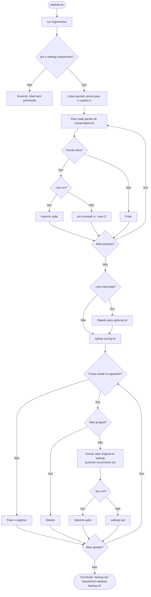

# Android Debloat (Motorola, sem root)

Scripts de shell que desativam pacotes para o usuário 0 e aplicam ajustes de `settings`. Não exigem root. Funcionam via ADB no PC ou via aShell/Shizuku no próprio aparelho.

## Arquivos

| Caminho | Função |
|---|---|
| `debloat.sh` | Desativa pacotes e aplica os ajustes. Aceita `--dry-run` e `--com-opcionais` |
| `revert.sh` | Reinstala os pacotes para o usuário 0 e restaura os valores do backup |
| `lib/common.sh` | Funções compartilhadas: pacotes, settings, backup e leitura das listas |
| `packages/conservative.txt` | Pacotes sem perda funcional esperada |
| `packages/optional.txt` | Pacotes que só entram com `--com-opcionais` |
| `settings/tuning.txt` | Ajustes no formato `namespace chave valor` |
| `tests/test_debloat.sh` | Testes de integração com mocks nomeados de `pm` e `settings` |

## Fluxo de execução



## Uso

Pelo PC, com ADB e depuração USB ativa:

```sh
adb push . /sdcard/mm-android-debloat
adb shell sh /sdcard/mm-android-debloat/debloat.sh --dry-run
adb shell sh /sdcard/mm-android-debloat/debloat.sh
```

Pelo aparelho, no aShell (com Shizuku autorizado): abra o terminal e rode `sh /sdcard/mm-android-debloat/debloat.sh --dry-run`.

Para reverter tudo:

```sh
sh /sdcard/mm-android-debloat/revert.sh
```

## Antes de rodar

- Rode sempre `--dry-run` primeiro e revise a lista de ações.
- O backup é gravado em `/sdcard/mm-debloat-backup.txt` apenas na primeira alteração de cada chave. Uma segunda execução não sobrescreve os valores originais.
- Chaves que não existem no seu aparelho são puladas e registradas na saída. A lista foi escrita sem validação em um Motorola específico, então algumas chaves podem não existir.

## Observações sobre os ajustes

- `global disable_window_blurs 1`: a opção fica em Opções do desenvolvedor. Se você desativar as opções do desenvolvedor, o Android restaura o valor padrão. Para manter, deixe as opções do desenvolvedor ativas e rode o script depois.
- `system peak_refresh_rate 60`: força 60 Hz. Economiza bateria, mas a animação fica menos fluida.
- `global dropbox_*`: efeito pequeno, serve só para reduzir gravação de logs.
- `global ble_scan_*` e `location_background_throttle_interval_ms`: reduzem varreduras e consultas de localização em segundo plano. Apps de rastreamento podem atualizar com menos frequência.

## Atenção nos pacotes

- `com.android.hotwordenrollment.okgoogle` e `.xgoogle`: desativam o "Ok Google" por voz. Assistente por botão continua funcionando.
- `com.motorola.ccc.mainplm` e `com.motorola.motocare`: não validei a função de cada um. Confirme no seu aparelho antes de remover.
- `com.motorola.gamemode` (opcional): Moto Gametime. Remove o modo jogo da Motorola; jogos continuam funcionando normalmente.

## Testes

```sh
sh tests/test_debloat.sh
```

Os testes usam mocks em `tests/fake_bin/` e não tocam em nenhum aparelho.

## Licença

GPL-3.0. Veja o arquivo `LICENSE`.
